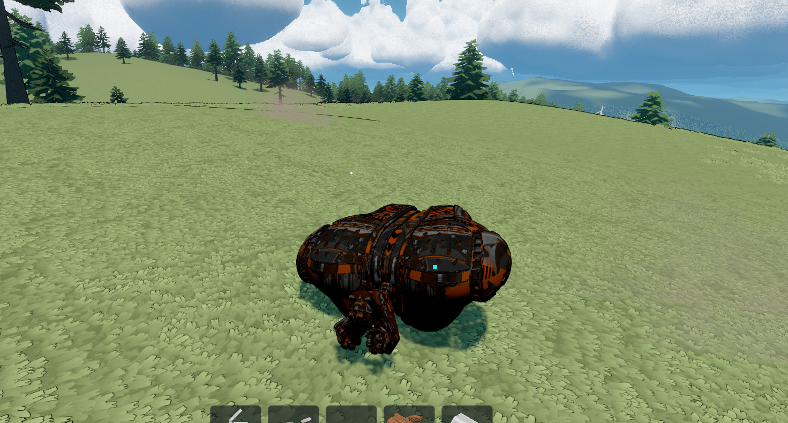

# Prospector Drone

**Created, edited, and maintained by Darkethereal.**

Prospector Drone adds a placeable machine and autonomous mining drone to StellarDrive. Select Wood, Copper, Glass, or Iron and the drone will locate the closest matching node in range, fly to it, mine it with the same health/depletion path used by the player's laser, capture the node's real debris yield, return, and unload into the station.

The station uses StellarDrive's vanilla Research Centre/Table model. An upright cyan hologram above each station reads `<player name>'s Prospector Drone`. The drone's home position is continuously locked to that specific table's live coordinates, so it returns to and rests on the table even if the supporting ship has moved.

## Requirements

- StellarDrive Demo
- MelonLoader 0.7.3 or compatible
- SDModKit 1.3.3 or compatible
- The host must install this mod. Version 0.3.22 is intentionally marked host-only.

## Installation

Install and enable both SDModKit and Prospector Drone through Stellar Mod Manager. The packaged DLL belongs in the game's `Mods` directory when installed.

## Building and placement

Research **Prospector Drone** after **Beacons**. Once unlocked, the station appears in the vanilla **Parts** build tab immediately after the Research Table and costs:

| Resource | Amount |
|---|---:|
| Iron | 30 |
| Glass | 8 |
| Copper | 20 |

Place it as a ship/base part using the normal build tool. Interact with it like a storage chest to open storage plus the drone control panel.

## Controls

- Select one target: Wood, Copper, Glass, or Iron.
- **Start** begins automatic mining.
- **Dock** cancels the current target and returns the visible drone with its cargo.
- Changing the resource recalls the active drone before it searches for the new selection.
- The station and drone cargo are single-resource locked. A different target cannot be selected until existing cargo and station stacks are cleared.
- The enlarged two-column station panel shows status and controls beside all six physical drone slots. Locked slots remain visible so the upgrade path is clear.

The drone never substitutes another resource. If none of the selected node type exists within range, it displays and briefly pops up `No [resource] found in range`, returns to the dock, and waits for Start to be pressed again.

The drone has its own persistent stack inventory, separate from station storage and the player inventory. Each slot follows the selected resource's real maximum stack size. It starts with one slot and reaches six slots through Cargo levels 1, 3, 5, 7, and 9. A full drone returns, descends onto the station, unloads into station storage, lifts off, and resumes mining automatically. Manual Recall returns and unloads before remaining paused.

## Base statistics and upgrades

| Upgrade | Level 0 | Increase per level | Level 10 |
|---|---:|---:|---:|
| Flight Speed | 8 m/s | +20% base speed | 24 m/s |
| Mining Speed | 1.00x | +0.25x | 3.50x |
| Drone Inventory | 1 slot | +1 slot every other level | 6 slots |
| Operating Range | 100 m | +50 m | 600 m |

Every track has ten upgrade levels. The panel displays ten filled/unfilled segments and the exact Iron, Copper, Wood, and Glass requirements for the next level. Affordability combines the interacting player's inventory with the station inventory; the station is spent first. Unaffordable buttons are visibly disabled, and purchases are validated on the server without partial charges.

## Saving

SDModKit persists the selected resource, automation setting, cargo quantities, and a shared Prospector upgrade profile in `sdmodkit-content.json` alongside each world save. Removing and rebuilding the table in the same game restores its Flight, Mining, Cargo, and Range levels. Different saves have independent profiles. The drone is safely restored at its station rather than mid-flight. The station inventory is the game's native `StorageState` and is saved normally by StellarDrive.

## Multiplayer

Mining, node depletion, cargo, unloading, configuration, access permissions, and upgrade purchases are host-authoritative. Access entries are persisted by Steam ID. Remote requests are accepted only while that player is interacting with the correct station. Version 0.3.22 does not network the custom moving drone mesh to remote clients; the host sees the full Drone Mk VII model and beam, while authoritative resources and station state remain synchronized through game/SDModKit state.

## Safety and recovery

- Nodes are filtered by their real drop item ID rather than object names.
- Nodes are reserved per drone to reduce duplicate targeting.
- A drone only collects debris emitted by the normal node-depletion pipeline.
- Cargo waits safely if station storage is full.
- Missing or depleted targets are released and rescanned.
- Recall and resource changes preserve cargo.
- A stalled drone performs a safe return without creating items.

## Troubleshooting

Check `MelonLoader/Latest.log` in the StellarDrive installation. Search for `ProspectorDrone`, `prospector-drone`, or `SDModKit`. Ensure SDModKit loads before this DLL and that both host and game versions match those listed above.

## Known limitations

- Drone flight is direct point-to-point and does not include obstacle pathfinding in 0.3.22.
- The custom moving drone visual is host-local in 0.3.22.
- A live in-world balance pass is still recommended for flight speed and scan radius.

## Credits and authorship

- Mod design, implementation, editing, packaging, and maintenance: **Darkethereal**.
- Built for StellarDrive using MelonLoader and SDModKit.
- Development was AI-assisted under Darkethereal's direction and testing.

See [LICENSE](LICENSE) and [NOTICE.md](NOTICE.md) for distribution and attribution details.
